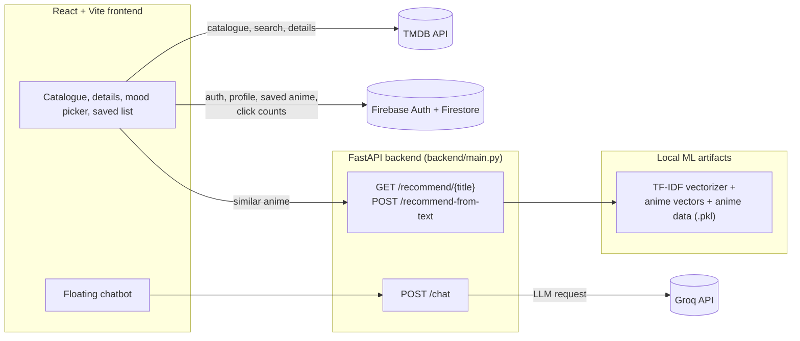

<a id="readme-top"></a>

<div align="center">

  

  <h1>Anime Hub AI</h1>

  <p><strong>A full-stack anime discovery app with a content-based recommendation engine and a separate AI chat assistant.</strong></p>

  <p>
    <a href="https://github.com/VaradP07/anime-AI-recommendation-system">Repository</a>
    ·
    <a href="#quick-start">Quick Start</a>
    ·
    <a href="#api-reference">API Reference</a>
    ·
    <a href="#how-the-recommendation-engine-works">How It Works</a>
    ·
    <a href="#known-limitations">Limitations</a>
  </p>

</div>

---

## Overview

Anime Hub AI is a React + FastAPI project that lets signed-in users browse and search an anime catalogue, get mood-based suggestions, save titles to a personal list, and receive recommendations for similar anime.

The project contains **three distinct pieces of "intelligence"**, and it is worth keeping them apart:

| Component | What it does | Data source |
| --- | --- | --- |
| **Content-based recommender** (`/recommend/*`) | Finds anime whose text features are similar to a chosen title using TF-IDF vectors and cosine similarity. | The bundled `backend/data/anime_data.csv` (1,000 anime) and the saved model files in `backend/ml/model/`. |
| **Groq chat assistant** (`/chat`) | A conversational assistant that answers anime questions. | A hosted LLM called through the Groq API. It is **not** connected to the local recommender or to Firebase. |
| **Mood discovery** | Maps a selected mood to TMDB genre and sort filters. | TMDB API. This is rule-based filtering, not machine learning. |

> **Status:** this repository is set up for local development. It does not link to a hosted deployment, and no tests or CI are configured.

## Features

- **Landing page and authentication** – animated landing page (GSAP), email/password sign-up and sign-in, and Google sign-in through Firebase Authentication. The `/anime` routes are protected.
- **Catalogue browsing** – search, filters, and popular / top-rated lists loaded from the TMDB API, plus a "Trending" row built from click counts stored in Firestore.
- **Mood-based discovery** – pick one of eight moods (Happy, Sad, Angry, Relaxed, Excited, Motivated, Romantic, Scared) to load TMDB results using a mood-to-genre mapping.
- **Anime details page** – details loaded from TMDB, with a "similar anime" section fetched from the local ML recommender.
- **Saved anime** – users can save and remove titles. Saved items are stored in Cloud Firestore per user.
- **Recommendation cards and ML info panel** – the home screen shows recommendations from the local model, and an information panel explains the approach.
- **Floating chatbot** – a chat widget that sends messages to the FastAPI `/chat` endpoint and renders replies with `react-markdown` and `remark-gfm`.

## Tech Stack

| Layer | Technologies |
| --- | --- |
| Frontend | React 18, Vite 5, JavaScript, Tailwind CSS, GSAP (`@gsap/react`), Lucide React, React Router 7, React Markdown, remark-gfm |
| Backend | Python, FastAPI, Uvicorn, Pydantic |
| Machine learning | pandas, scikit-learn (`TfidfVectorizer`, `cosine_similarity`), joblib |
| Chat assistant | Groq API (`groq` Python SDK) |
| Catalogue data | TMDB API |
| Auth and user data | Firebase Authentication, Cloud Firestore |

## Architecture



**Two separate request paths:**

1. **Recommendations:** the frontend sends a title to `/recommend/{title}`. The backend looks the title up in the local dataset, compares its TF-IDF vector with all others, and returns the closest matches.
2. **Chat:** the frontend sends the message and recent history to `/chat`. The backend forwards them, with a system prompt, to Groq and returns the reply. The local recommender is never consulted, so chatbot suggestions are the language model's own output and are not ML-model results.

## How the Recommendation Engine Works

### Dataset

`backend/data/anime_data.csv` has **1,000 rows** and five columns: `id`, `title`, `genres`, `overview`, `image`.

According to `backend/download_dataset.py`, the file was produced by taking the 1,000 anime with the most list users from a larger source CSV (`data/original_anime_dataset.csv`, which is **not** included in this repository). Two details matter for interpreting results:

- Titles are the romanised, MyAnimeList-style titles (for example `Shingeki no Kyojin`), and `image` values are MyAnimeList CDN URLs.
- The `overview` column is **not** a plot synopsis. It is generated by that script in the form `Genres: … Studio: … Rating: …`. The model therefore mostly learns from genres, studio names and rating tokens.

### Training (`backend/ml/train_model.py`)

1. Load the CSV and verify the required columns exist.
2. Fill missing values, drop duplicate `id`s, strip whitespace.
3. Lowercase `genres` and `overview`.
4. Build `combined_features = genres + " " + genres + " " + overview` (genres are repeated to weight them more heavily).
5. Fit `TfidfVectorizer(stop_words="english", max_features=10000)` on the combined text.
6. Save three files with joblib to `backend/ml/model/` (see [Model artifacts](#model-artifacts)).

The committed vectorizer has a vocabulary of 374 terms (the 10,000 value is only an upper limit).

### Recommending (`backend/ml/recommender.py`)

- **`get_recommendations(title, n=10)`** – exact, case-insensitive title match against the dataset; computes cosine similarity between that anime's vector and every other vector; skips the anime itself; keeps results with similarity **≥ 0.30**; returns up to `n` results sorted by similarity. If the title is not in the dataset, the result is an empty list.
- **`get_recommendations_from_text(title, genres, overview, n=10)`** – builds `genres + genres + overview` for an anime that is not in the dataset, transforms it with the saved vectorizer, and ranks dataset anime the same way (same 0.30 threshold). Returns an empty list when both `genres` and `overview` are empty.
- **Title aliases** – `backend/main.py` contains a small alias table (for example `attack on titan` → `Shingeki no Kyojin`) so a few common English names resolve to dataset titles. Titles outside the dataset and not in the alias table return no recommendations.

### How to read the similarity score

The `similarity` field is a **cosine similarity between TF-IDF vectors, from 0 to 1**. It measures how much two text descriptions overlap in weighted vocabulary. It is **not** a probability, a predicted rating, or a guarantee that a user will like a title. Because the underlying text is mostly genres, studio and rating, high scores largely indicate shared genre/studio tokens.

### Evaluation methodology and caveat

`backend/ml/evaluate_model.py` computes Precision@5, Precision@10, catalogue coverage and average top-10 similarity across the whole dataset. A recommendation counts as "relevant" when it **shares at least one genre** with the source anime.

Please treat its output as a **sanity check, not real-world accuracy**:

- Genre overlap is only a proxy for relevance, and genres are also the main input to the model, so the check is partly circular and tends to look favourable.
- There is no user feedback, click-through data, or held-out preference data involved.
- The script does not apply the 0.30 similarity threshold used by the API.
- The figures shown in the frontend's ML info panel (`src/components/AIModelInfo.jsx`) are hard-coded text, not live output. This README does not quote them; run the script yourself if you want current numbers.

## Repository Structure

```text
anime-AI-recommendation-system/
├── backend/
│   ├── main.py                 # FastAPI app: /, /recommend, /recommend-from-text, /chat
│   ├── requirements.txt        # Python dependencies (see "Requirements" for a gap)
│   ├── data/
│   │   └── anime_data.csv      # 1,000-anime dataset
│   ├── ml/
│   │   ├── train_model.py      # Builds TF-IDF artifacts from the CSV
│   │   ├── recommender.py      # Loads artifacts, cosine-similarity recommendations
│   │   ├── evaluate_model.py   # Genre-overlap proxy evaluation
│   │   └── model/              # tfidf_vectorizer.pkl, anime_vectors.pkl, anime_data.pkl
│   ├── recommender.py          # Older standalone recommender; not used by main.py
│   ├── download_dataset.py     # One-off script that built the CSV from a larger source file
│   └── add_images.py           # One-off script that fills image URLs via the Jikan API
├── src/
│   ├── main.jsx, App.jsx       # Entry point and routes (/, /login, /anime, /anime/:id)
│   ├── animeApp.jsx            # Main catalogue screen
│   ├── firebase.js             # Firebase Auth + Firestore helpers
│   ├── recommendationModel.js  # Demographic-similarity helper (see Limitations)
│   └── components/             # Hero, Navbar, Auth, AnimeCard, AnimeDetails, AnimeChatbot,
│                               # MoodDetector, Filter, Search, AIModelInfo, SaveAnimeButton, ...
├── public/                     # Static assets (images, fonts, video, audio)
├── package.json                # Frontend scripts and dependencies
├── vite.config.js, tailwind.config.js, postcss.config.js, eslint.config.js
└── vercel.json                 # SPA rewrite rule (no deployment is claimed by this README)
```

## Requirements

- **Node.js and npm** – a version supported by Vite 5 (Node 18 or newer).
- **Python 3** – developed on 3.13. Use a virtual environment.
- **A TMDB account** – the frontend needs a TMDB token (see below).
- **A Firebase project** – with Email/Password and Google sign-in enabled, and Cloud Firestore created.
- **A Groq API key** – only needed for the chatbot.

> **Dependency gap:** `backend/requirements.txt` currently lists only `pandas`, `scikit-learn`, `joblib`, `fastapi` and `uvicorn`. However, `backend/main.py` also imports `groq` and `python-dotenv` (`from groq import Groq`, `from dotenv import load_dotenv`). The backend will not start until you install those two packages as well; the setup steps below include that command. Fixing `requirements.txt` is listed under [Future Improvements](#future-improvements).

## Quick Start

You will run two processes: the FastAPI backend and the Vite frontend.

### 1. Clone

```bash
git clone https://github.com/VaradP07/anime-AI-recommendation-system.git
cd anime-AI-recommendation-system
```

### 2. Backend setup

Run these from the `backend` folder.

**Windows PowerShell**

```powershell
cd backend
python -m venv venv
.\venv\Scripts\Activate.ps1
python -m pip install --upgrade pip
pip install -r requirements.txt
pip install groq python-dotenv
```

If activation is blocked, run `Set-ExecutionPolicy -Scope Process -ExecutionPolicy Bypass` in the same window and activate again.

**macOS / Linux**

```bash
cd backend
python3 -m venv venv
source venv/bin/activate
python -m pip install --upgrade pip
pip install -r requirements.txt
pip install groq python-dotenv
```

Create `backend/.env` (this file is git-ignored):

```env
GROQ_API_KEY=your_groq_api_key_here
GROQ_MODEL=openai/gpt-oss-20b
```

`GROQ_MODEL` is optional; the code defaults to `openai/gpt-oss-20b`. Without `GROQ_API_KEY` the API still starts and the recommendation endpoints work, but `/chat` returns an error.

Start the API **from the `backend` folder** (the app imports `ml.recommender` using a path relative to it):

```bash
uvicorn main:app --reload --port 8000
```

Check it at <http://127.0.0.1:8000/> – you should see `{"message": "Anime Recommendation API is running"}`. FastAPI's interactive docs are available at <http://127.0.0.1:8000/docs>.

### 3. Frontend setup

Open a second terminal at the **repository root**.

```bash
npm install
```

Create `.env.local` in the repository root (git-ignored by `*.local` and `.env.*`):

```env
# TMDB – see the note below about which kind of token to use
VITE_TMDB_API_KEY=your_tmdb_read_access_token_here

# Firebase web app config (Firebase console -> Project settings -> Your apps)
VITE_FIREBASE_API_KEY=your_firebase_api_key
VITE_FIREBASE_AUTH_DOMAIN=your_project_id.firebaseapp.com
VITE_FIREBASE_PROJECT_ID=your_project_id
VITE_FIREBASE_STORAGE_BUCKET=your_project_id.appspot.com
VITE_FIREBASE_MESSAGING_SENDER_ID=your_sender_id
VITE_FIREBASE_APP_ID=your_app_id
VITE_FIREBASE_MEASUREMENT_ID=your_measurement_id
```

> **TMDB token:** the code sends `Authorization: Bearer <VITE_TMDB_API_KEY>`, so this value must be TMDB's **API Read Access Token** (the long v4 token), not the short v3 API key.

In the Firebase console, enable **Authentication → Email/Password** and **Google**, and create a **Firestore** database. Firestore security rules are not part of this repository, so configure your own.

Start the frontend. **The script in `package.json` is named `Animehub`, not `dev`:**

```bash
npm run Animehub
```

Open <http://localhost:5173>. The backend's CORS configuration only allows `http://localhost:5173` and `http://localhost:5174`, so run the frontend on one of those origins.

### Other commands

| Command | Where | Purpose |
| --- | --- | --- |
| `npm run build` | repo root | Production build of the frontend |
| `npm run preview` | repo root | Serve the production build locally |
| `npm run lint` | repo root | Run ESLint |
| `python ml/train_model.py` | `backend/` | Rebuild the three model files from the CSV (overwrites `backend/ml/model/*.pkl`) |
| `python ml/evaluate_model.py` | `backend/` | Run the genre-overlap proxy evaluation |
| `python ml/recommender.py` | `backend/` | Print sample recommendations for "Death Note" |

> **Local URLs:** the frontend hard-codes the backend address `http://127.0.0.1:8000` in several files. If you change the backend host or port, update those references.

## API Reference

Base URL (local): `http://127.0.0.1:8000`

### `GET /`

Health check.

```bash
curl http://127.0.0.1:8000/
```

```json
{ "message": "Anime Recommendation API is running" }
```

### `GET /recommend/{title}`

Returns up to 10 similar anime from the local dataset using TF-IDF + cosine similarity. The title is matched against the dataset case-insensitively after passing through the alias table.

```bash
curl "http://127.0.0.1:8000/recommend/Death%20Note"
```

```powershell
Invoke-RestMethod "http://127.0.0.1:8000/recommend/Death%20Note"
```

Example response (truncated to two results; produced by the committed model files):

```json
{
  "input_anime": "Death Note",
  "matched_dataset_title": "Death Note",
  "recommendations": [
    {
      "id": 16762,
      "title": "Mirai Nikki: Redial",
      "genres": "psychological, shounen, supernatural, suspense",
      "image": "https://cdn.myanimelist.net/images/anime/1715/103523.jpg",
      "similarity": 0.8428
    },
    {
      "id": 43299,
      "title": "Wonder Egg Priority",
      "genres": "drama, psychological, supernatural, suspense",
      "image": "https://cdn.myanimelist.net/images/anime/1079/110751.webp",
      "similarity": 0.7374
    }
  ]
}
```

If the title is not in the dataset (or no result reaches the 0.30 threshold), the response is still `200` with `"recommendations": []`.

### `POST /recommend-from-text`

Recommends dataset anime for a title that is *not* in the dataset, using the genres and/or overview you supply. At least one of `genres` or `overview` should be non-empty, otherwise the list is empty. The bundled frontend does not currently call this endpoint.

| Field | Type | Required |
| --- | --- | --- |
| `title` | string | yes |
| `genres` | string | no (default `""`) |
| `overview` | string | no (default `""`) |

```bash
curl -X POST http://127.0.0.1:8000/recommend-from-text \
  -H "Content-Type: application/json" \
  -d '{"title": "My Example Anime", "genres": "Action, Fantasy", "overview": "A young swordsman travels a magical land."}'
```

```powershell
Invoke-RestMethod -Method Post -Uri "http://127.0.0.1:8000/recommend-from-text" `
  -ContentType "application/json" `
  -Body '{"title":"My Example Anime","genres":"Action, Fantasy","overview":"A young swordsman travels a magical land."}'
```

Response shape: `{ "input_anime": "...", "recommendations": [ { id, title, genres, image, similarity }, ... ] }`.

### `POST /chat`

Conversational assistant powered by **Groq**. This endpoint does not use the TF-IDF model or Firebase.

| Field | Type | Notes |
| --- | --- | --- |
| `message` | string | Required. Trimmed; must be non-empty and at most 2,000 characters. |
| `history` | array of `{ "role": "user" \| "assistant", "content": string }` | Optional. Only the last 8 items with valid roles and content up to 2,000 characters are used. |

```bash
curl -X POST http://127.0.0.1:8000/chat \
  -H "Content-Type: application/json" \
  -d '{"message": "Suggest a few beginner-friendly anime.", "history": []}'
```

```powershell
Invoke-RestMethod -Method Post -Uri "http://127.0.0.1:8000/chat" `
  -ContentType "application/json" `
  -Body '{"message":"Suggest a few beginner-friendly anime.","history":[]}'
```

Success response: `{ "reply": "..." }`

| Status | Meaning |
| --- | --- |
| `400` | Empty message, or message longer than 2,000 characters |
| `500` | `GROQ_API_KEY` is not set |
| `502` | The Groq request failed (invalid key, unavailable model, usage limits, …) |

Because the reply comes from a language model, titles and facts in it can be wrong; the system prompt asks the model not to guess, but nothing verifies its output.

## Model Artifacts

All files live in `backend/ml/model/` and are created by `python ml/train_model.py` (run from `backend/`).

| File | Contents | Used by |
| --- | --- | --- |
| `tfidf_vectorizer.pkl` | The fitted scikit-learn `TfidfVectorizer` (vocabulary and IDF weights). Needed to vectorize text for `/recommend-from-text`. | `ml/recommender.py`, `ml/evaluate_model.py` |
| `anime_vectors.pkl` | Sparse TF-IDF matrix for the dataset (1,000 rows × vocabulary size). | `ml/recommender.py`, `ml/evaluate_model.py` |
| `anime_data.pkl` | pandas DataFrame with `id`, `title`, `genres`, `overview`, `image`, aligned row-for-row with the vectors. | `ml/recommender.py` |

Notes:

- The committed files were saved with scikit-learn **1.9.0**. Loading them with a different version can print an `InconsistentVersionWarning`. If you see it, either install the matching version or retrain with `python ml/train_model.py`.
- `.pkl` files are Python pickles. Only load model files from sources you trust.
- The vectors, data and vectorizer must come from the same training run. If you retrain, keep all three files together.

## Firestore Data Used by the App

Based on `src/firebase.js`:

| Path | Purpose |
| --- | --- |
| `users/{uid}` → `prefs` | Profile fields saved at sign-up (name, email, profile picture, age, phone, state, country) |
| `users/{uid}/saved_movies/{id}` | A user's saved titles (stores the TMDB id and a timestamp) |
| `movie_clicks/{id}` | Click counters used for the "Trending" row |

## Troubleshooting

| Symptom | Likely cause and fix |
| --- | --- |
| `npm run dev` fails with "Missing script" | The script is named `Animehub`. Use `npm run Animehub`. |
| `ModuleNotFoundError: No module named 'dotenv'` or `'groq'` | These are missing from `requirements.txt`. Run `pip install groq python-dotenv` inside the activated virtual environment. |
| `ModuleNotFoundError: No module named 'ml'` | Uvicorn was started outside `backend/`. `cd backend` first, then `uvicorn main:app --reload --port 8000`. |
| PowerShell refuses to activate the venv | Run `Set-ExecutionPolicy -Scope Process -ExecutionPolicy Bypass`, then `.\venv\Scripts\Activate.ps1`. |
| Browser console shows a CORS error | The frontend is running on an origin other than `http://localhost:5173` / `5174`. Use one of those, or edit `allow_origins` in `backend/main.py`. |
| AI recommendations are empty or "temporarily unavailable" | The backend is not running on port 8000, or the title is not in the 1,000-anime dataset (and not in the alias table). Try `curl http://127.0.0.1:8000/recommend/Death%20Note`. |
| Chatbot shows an error; `/chat` returns 500 | `GROQ_API_KEY` is missing or `backend/.env` was not loaded. Restart Uvicorn after editing `.env`. |
| `/chat` returns 502 | Check the key, that `GROQ_MODEL` is available to your account, and your Groq usage limits. The backend console prints the underlying error. |
| TMDB requests fail with 401 | `VITE_TMDB_API_KEY` must be the TMDB **Read Access Token**, not the v3 API key. |
| Blank page or Firebase "invalid-api-key" errors | `.env.local` is missing or a variable is empty. Vite only reads env files at startup, so restart `npm run Animehub` after editing. |
| `InconsistentVersionWarning` from scikit-learn | The installed version differs from the one that saved the `.pkl` files. Match the version or run `python ml/train_model.py` to regenerate them. |
| `Address already in use` on port 8000 | Stop the other process, or use another port and update the hard-coded URLs in `src/`. |

## Known Limitations

- **Small, static dataset.** Recommendations come only from the 1,000 anime in the CSV; new releases are not added automatically.
- **Text features are thin.** The `overview` is generated from genres, studio and rating rather than a plot description, so similarity mostly reflects shared genre/studio tokens.
- **Catalogue and model use different sources.** The catalogue comes from TMDB, while the recommender uses MyAnimeList-style titles. The link between them is a title match (plus a short alias table), so many TMDB titles will not match and will return no recommendations. There is no ID mapping between the two.
- **No personalisation in the ML recommender.** It is item-to-item similarity; it does not learn from a user's saved list or behaviour.
- **Home recommendations are fixed.** The home section requests recommendations for a hard-coded title (`Naruto`).
- **Similarity is not preference.** Scores are TF-IDF overlap measures, not predicted enjoyment.
- **Evaluation is a proxy.** See [Evaluation methodology and caveat](#evaluation-methodology-and-caveat).
- **Chatbot accuracy.** Groq-generated answers are not verified against any dataset.
- **Local-only configuration.** The backend URL is hard-coded to `http://127.0.0.1:8000`, and CORS allows only two localhost origins.
- **No tests or CI.** None are included in the repository.
- **No license file.** The repository does not currently include a license, so reuse terms are unspecified.

## Future Improvements

- Add `groq` and `python-dotenv` to `backend/requirements.txt` and pin versions (especially `scikit-learn`, to match the committed artifacts).
- Add a conventional `dev` script to `package.json` (or keep `Animehub` and document it, as done here).
- Move the API base URL and CORS origins into environment variables; add `.env.example` files for both apps.
- Enrich the dataset with real synopses and richer metadata, and map TMDB ids to dataset ids.
- Use saved-anime history to personalise results (hybrid content + collaborative approach).
- Evaluate with held-out or user-feedback data instead of genre overlap.
- Add rate limiting for `/chat`, and Firestore security rules to the repo.
- Add automated tests (API endpoints, recommender functions, key UI flows) and a CI workflow.

## Acknowledgements

- Catalogue data and images are provided through the [TMDB API](https://www.themoviedb.org/). *This product uses the TMDB API but is not endorsed or certified by TMDB.*
- The bundled dataset's titles and image links originate from MyAnimeList-style data; the image URLs point to MyAnimeList's CDN.
- Icons by [Lucide](https://lucide.dev/).

<p align="right"><a href="#readme-top">Back to top ↑</a></p>